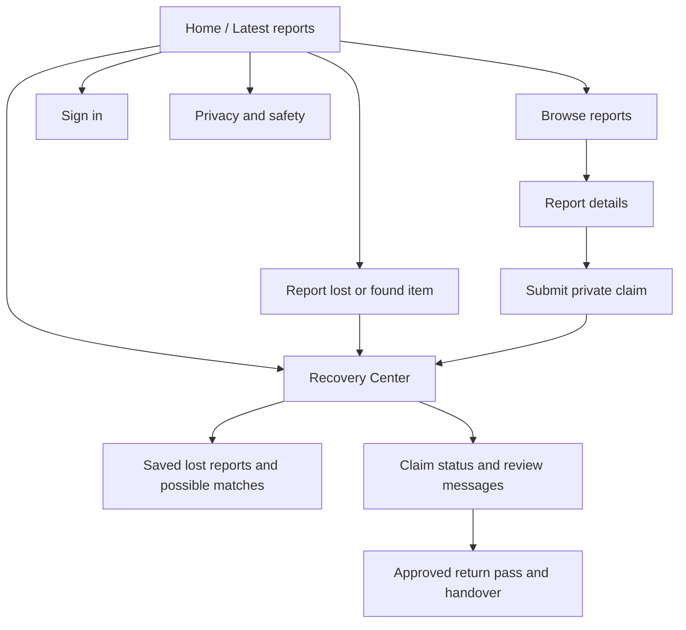

# FoundIt sitemap and wireframes

## Sitemap



## Page and flow notes

- **Home / Browse:** public reports, filters, item photos, and clear labels that suggested matches are not ownership proof.
- **Report:** signed-in users create a lost or found report. A photo is optional; public photos should not reveal private clues.
- **Report details / Claim:** claimant submits identifying details privately through ClueLock. Those details do not belong in the public report.
- **Recovery Center:** signed-in users follow their own reports, saved watchlist entries, match reasons, claim status, and return progress.
- **Review:** the report owner or configured staff can request details, approve, reject, or escalate a claim.
- **SafeReturn:** after approval, claimant and authorized finder/staff confirm the handover separately.
- **Privacy and safety:** explains public versus private information and safe claiming practices.

## Wireframes (content structure)

### Desktop home

```text
┌────────────────────────────────────────────────────────────────────┐
│ FoundIt       Browse   Recovery Center   Report       Sign in      │
├────────────────────────────────────────────────────────────────────┤
│ Campus lost & found              [campus image fades behind text]   │
│ Lost something? Let's bring it back.                                │
│ Browse reports, follow possible matches, use safer verification.    │
│ [Browse items] [Report an item]                                     │
├────────────────────────────────────────────────────────────────────┤
│ Start here / key recovery steps                                     │
│ Latest reports: [card] [card] [card]                                │
│ Footer: Privacy and safety                                          │
└────────────────────────────────────────────────────────────────────┘
```

### Mobile home

```text
┌──────────────────────┐
│ FoundIt       [Menu] │
├──────────────────────┤
│ Lost something?      │
│ Let's bring it back. │
│ [Browse items]       │
│ [Report an item]     │
├──────────────────────┤
│ Latest reports       │
│ [report card]        │
│ [report card]        │
│ Recovery Center      │
└──────────────────────┘
```

### Recovery Center

```text
┌────────────────────────────────────────────────────┐
│ Your reports / saved watchlist                     │
│ Reported → Possible Match → Claim → Verification   │
│ → Approved → Return Confirmed                      │
│ [match reasons] [claim status / next step]         │
└────────────────────────────────────────────────────┘
```

The sketches describe the intended content hierarchy, not pixel-perfect measurements. Use screenshots of the published website as the actual visual evidence.
